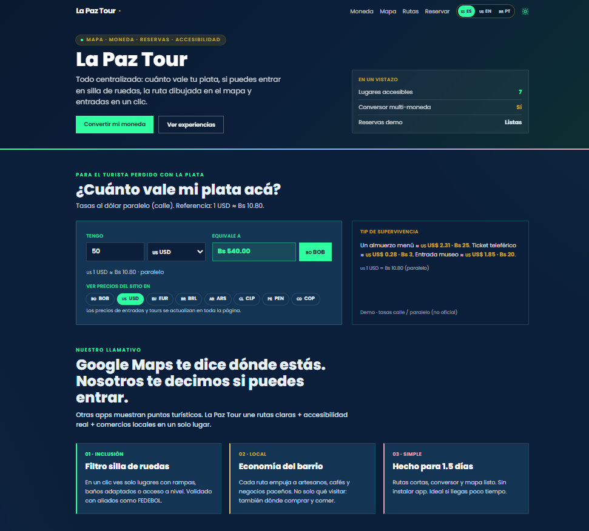
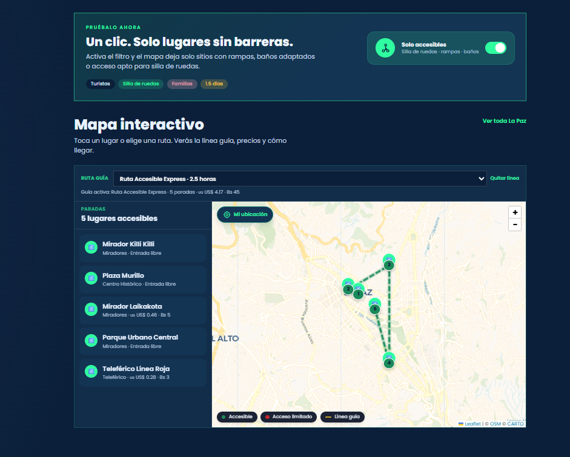
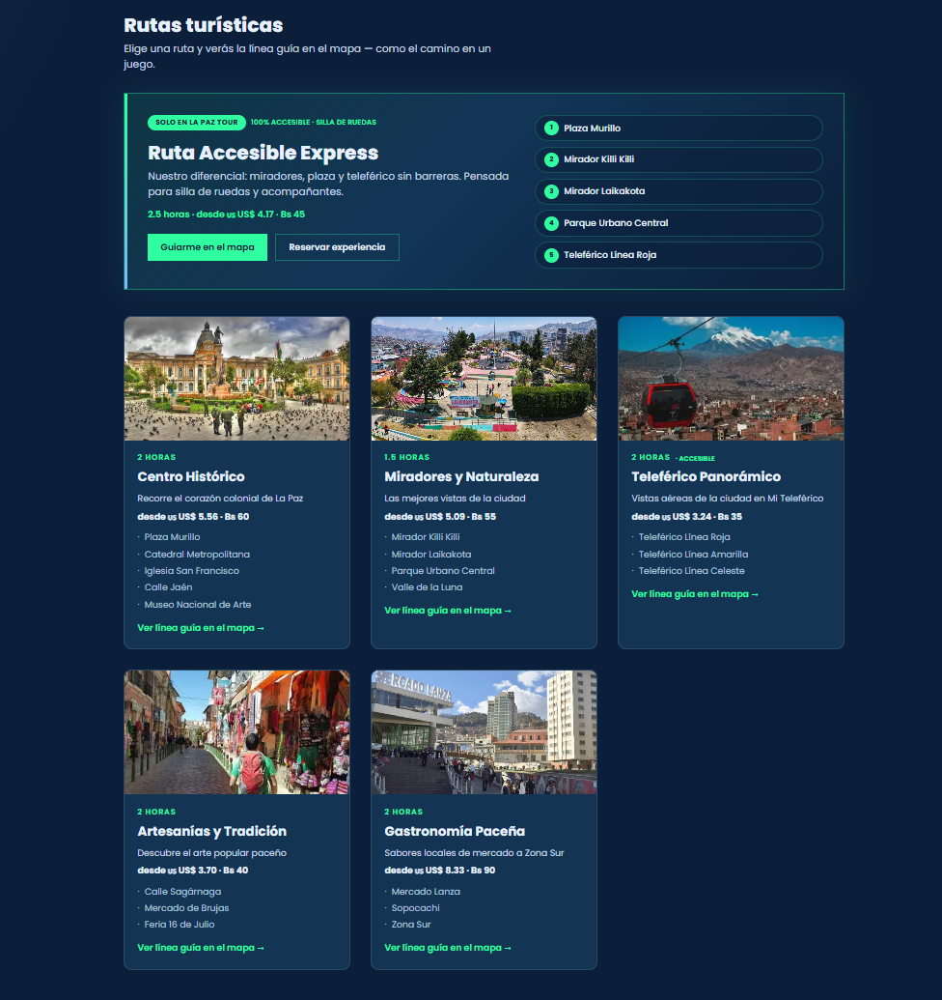
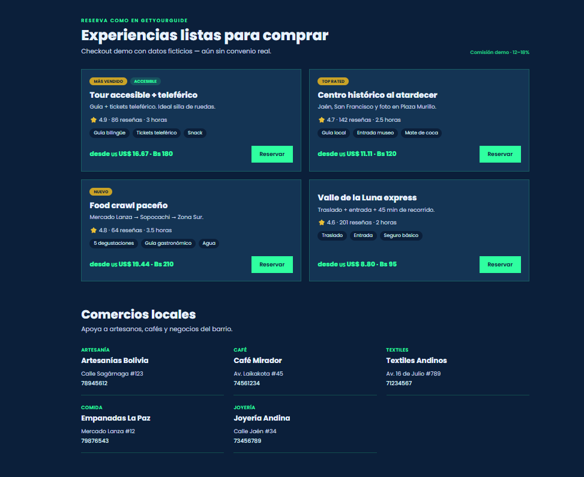
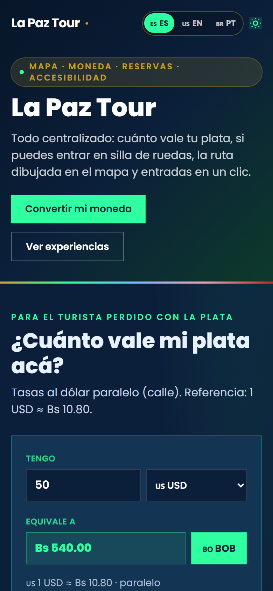

# La Paz Tour

**Google Maps te dice dónde estás. La Paz Tour te dice si puedes entrar.**

Guía web de turismo accesible para La Paz, Bolivia. Está pensada para quien llega con poco tiempo y muchas dudas: cuánto vale su plata, qué lugares puede recorrer en silla de ruedas, qué ruta hacer y cómo reservarla. Todo en una sola página, sin instalar nada y sin APIs de pago.

### 🔗 [Ver demo en vivo → la-paz-tour.vercel.app](https://la-paz-tour.vercel.app/)



## Funcionalidades

**Mapa y accesibilidad**

- **Mapa interactivo** con Leaflet y teselas de OpenStreetMap (CARTO): 15 atracciones en la lista principal y 4 puntos más que aparecen solo dentro de las rutas, 19 en total.
- **Filtro "Solo accesibles"**: con un clic, el mapa y la lista se quedan solo con los lugares que tienen rampas, baños adaptados o acceso a nivel (7 de las 15 atracciones). Los pines distinguen accesible y acceso limitado.
- **Popups completos**: foto, descripción, características de accesibilidad, precio de entrada en la moneda elegida, horario, teléfono, WhatsApp y enlace "cómo llegar" a Google Maps.
- **"Mi ubicación"** con la API de geolocalización del navegador. Si el usuario no da permiso, el mapa vuelve al centro de La Paz.

**Rutas**

- **6 rutas turísticas** dibujadas como polilínea guía sobre el mapa, con paradas numeradas y encuadre automático: Ruta Accesible Express (destacada, apta para silla de ruedas), Centro Histórico, Miradores y Naturaleza, Teleférico Panorámico, Artesanías y Tradición y Gastronomía Paceña.
- Cada ruta muestra su duración, sus paradas y un precio estimado. Se puede activar desde el selector del mapa o desde su tarjeta.

**Moneda, idioma y tema**

- **Conversor de 8 monedas** (BOB, USD, EUR, BRL, ARS, CLP, PEN, COP) con tasa paralela de referencia. Al elegir una moneda se actualizan en vivo **todos los precios de la página**: entradas, rutas, experiencias y el total del checkout.
- **Trilingüe ES / EN / PT** con un sistema i18n propio, sin librerías.
- **Modo claro/oscuro** que respeta la preferencia del sistema y se recuerda entre visitas.

**Economía local**

- **Experiencias tipo marketplace** (4 experiencias de demo) con un checkout que calcula el total según la cantidad de personas y genera un código de reserva `LPT-XXXX`. No hay cobro real.
- **Directorio de comercios locales** (artesanía, café, textiles, comida, joyería) con llamada directa, y una tabla de aliados del proyecto.

| Mapa con filtro y ruta accesible                                                   | Rutas turísticas                                    |
| ---------------------------------------------------------------------------------- | --------------------------------------------------- |
|  |  |

| Experiencias y comercios                                                   | Móvil                                                  |
| -------------------------------------------------------------------------- | ------------------------------------------------------ |
|  |  |

## Stack

| Capa        | Tecnología                                                                  |
| ----------- | --------------------------------------------------------------------------- |
| Framework   | Astro 4 (sitio estático, una sola página)                                   |
| Estilos     | Tailwind CSS 3 con paleta propia y `darkMode: 'class'`                      |
| Mapa        | Leaflet 1.9.4 (por CDN, con Subresource Integrity) y teselas OSM de CARTO   |
| Lógica      | JavaScript vanilla en los `<script>` de los componentes Astro               |
| i18n        | Diccionario propio (ES / EN / PT) con atributos `data-i18n`                 |
| Deploy      | Vercel                                                                      |

## Decisiones técnicas

### Cero API keys, cero costo

El mapa usa Leaflet con teselas de OpenStreetMap servidas por CARTO, sin registro ni clave. "Cómo llegar" abre una URL de Google Maps (`/maps/dir/?api=1&destination=lat,lng`), que tampoco necesita clave. Las tasas de cambio están en `src/data/data.js`. Con eso el proyecto se publica gratis, no tiene secretos que filtrar y no deja de funcionar si se vence una cuota.

### Precios en bolivianos, convertidos en el cliente

Todos los precios se guardan en Bs y se renderizan con un atributo `data-price-bob`. Al cambiar de moneda, el conversor:

1. Guarda la moneda en `localStorage` (`lpt-moneda`).
2. Emite el evento personalizado `lpt-currency-change`.
3. Vuelve a formatear cada `[data-price-bob]` de la página.

El mapa y el checkout escuchan el mismo evento para regenerar sus popups, la lista y el total. Los componentes no se conocen entre sí, solo comparten el evento. La función de formato queda en `window.lptFormatPrecio`, así el contenido que se genera después (popups, lista de lugares) usa la misma lógica.

### i18n sin librerías

`src/i18n/translations.js` tiene un diccionario con **99 claves por idioma** y una función `t(key, lang, vars)` que, si falta una traducción, cae al español y luego a la clave. En el HTML los textos se marcan con `data-i18n` (90 nodos). El mismo sistema también traduce HTML, placeholders y `aria-label` (`data-i18n-html`, `data-i18n-placeholder`, `data-i18n-aria`). Al cambiar de idioma se actualiza `<html lang>`, se guarda la elección (`lpt-lang`) y se emite `lpt-lang-change` para que el mapa traduzca su contenido dinámico. No se usa ninguna dependencia ni se recarga la página.

### Modelo de datos de accesibilidad

Cada lugar declara `accesible` (booleano, para filtrar) y `features` (lista legible para el turista: "Rampa", "Baño adaptado", "Ascensor", "Escaleras en la entrada"…). El booleano decide el filtro, el pin y la insignia, y las `features` explican por qué. Los puntos que solo sirven para trazar rutas llevan `ocultoLista: true`, así no aparecen en la lista general pero sí en su recorrido. Las rutas referencian lugares por `id`, de modo que la fuente de datos es una sola.

### Accesibilidad de la propia interfaz

Un sitio sobre accesibilidad también tiene que ser accesible:

- El contador de resultados y la ruta activa usan `aria-live="polite"`.
- Los botones de moneda, idioma y tema exponen su estado con `aria-pressed`.
- El interruptor del filtro es un `checkbox` real (oculto con `sr-only`) y se ve el foco con `:focus-visible`.
- La lista de lugares usa `role="listbox"` y `aria-selected`, y el checkout es un `role="dialog"` con `aria-modal`.

### Rendimiento de sitio estático

Astro genera HTML estático en el build y no se envía ningún framework al cliente: solo el JS de los componentes interactivos y Leaflet. Un script inline en el `<head>` aplica el tema oscuro antes del primer pintado, para que no haya un destello blanco. Las imágenes de los lugares están en WebP/JPG locales y las de las rutas se cargan con `loading="lazy"`.

## Puesta en marcha

Requisitos: Node.js 18.17+ (o 20+).

```bash
git clone https://github.com/nnvaldev/LaPazTour.git
cd LaPazTour
npm install
npm run dev        # http://localhost:4321
```

```bash
npm run build      # genera dist/
npm run preview    # sirve el build localmente
```

No hace falta ningún archivo `.env`: el proyecto no usa claves ni servicios externos de pago.

## Estructura

```
src/
├── pages/index.astro          página única + lógica del mapa (filtro, rutas, geolocalización)
├── components/
│   ├── Layout.astro           <head>, Leaflet por CDN, tema claro/oscuro sin destello
│   ├── Conversor.astro        conversor y recálculo de precios en toda la página
│   ├── LangSwitcher.astro     cambio de idioma ES / EN / PT
│   ├── Mapa.astro             mapa, selector de ruta, lista de paradas y leyenda
│   ├── Rutas.astro            ruta destacada y tarjetas de rutas
│   ├── Experiencias.astro     marketplace y modal de checkout demo
│   ├── Diferencial.astro      propuesta de valor
│   ├── Comercios.astro        directorio de comercios locales
│   └── Aliados.astro          tabla de aliados
├── data/data.js               lugares, rutas, monedas, experiencias, comercios, aliados
├── i18n/translations.js       diccionario y función t()
└── styles/globals.css
public/img/                    fotos de los lugares
```

## Alcance del MVP

Es un MVP de demostración: las tasas de cambio son de referencia y fijas, las experiencias, reseñas y el checkout usan datos ficticios, y no se procesa ningún pago. Los textos de la interfaz están en tres idiomas, pero los datos (nombres, descripciones y rutas) por ahora solo están en español.

## Próximos pasos

- [ ] Traducir también los datos de lugares, rutas y experiencias.
- [ ] Tasas de cambio actualizadas desde una fuente pública.
- [ ] Teselas oscuras para el mapa en modo oscuro.
- [ ] Más lugares validados en terreno con organizaciones de personas con discapacidad.

---

Desarrollado por **Alexander Castillo** ([@nnvaldev](https://github.com/nnvaldev)) · La Paz, Bolivia.
